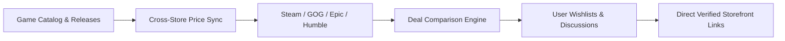

# [BuckShot](https://buckshotgames.vercel.app)

> A cinematic game catalog and deal discovery storefront connecting gamers with live prices, updates, and community discussions across major digital platforms.

---

## About

You love games, I love games. You want the best deals to purchase them, and so do I! 

**BuckShot** was built to guide players directly to the best deals and editions across various digital storefronts. Whether you're scouting for historic lows, day-one launches, community impressions, or upcoming blockbusters, this platform curates and tracks prices so you never overpay for your next adventure.

---

## How It Works

1. **Curated Indexing**: Games are organized into canonical tracks — *New Releases*, *Trending Charts*, *Recent Updates*, *Upcoming*, and *Store Exclusives*.
2. **Cross-Platform Price Aggregation**: Official digital storefront prices (Steam, Epic Games Store, GOG, Humble, PlayStation, Xbox) are tracked and indexed.
3. **Automated Publishing & Pipeline**: Draft and upcoming games automatically transition to active catalog entries the moment their release date arrives.
4. **Community & Discussions**: Verified users can participate in title discussions, build custom wishlists, track patches, and vote on community ratings.

---

## Features

- **Cross-Storefront Price Tracking**: Compare prices, historical low badges, and special editions across multiple official digital platforms.
- **Cinematic Storefront Experience**: Built with a sleek AAA launcher aesthetic inspired by modern entertainment hubs — sharp geometry, fluid motion, and ambient color theming.
- **Curated Category & Tag Discovery**: Browse titles tailored by genres (*Souls-like*, *Action*, *RPG*, *Strategy*), and tags (*Trending*, *New Releases*, *Latest Patches*, *Early Access*).
- **Scheduled Auto-Publishing**: Built-in automated scheduler for releases — titles transition from "Coming Soon" to "New Releases" without manual intervention.
- **Personal Library & Wishlists**: Track games you own, save upcoming titles to your wishlist, and receive release notifications.
- **Community Discussions & Moderation**: Threaded comments, user roles (Admin, Moderator, Repacker, Veteran, Seeder), and content moderation.
- **Admin Dashboard (restricted access)**: Comprehensive CMS for managing game metadata, media uploads (Cloudinary), cross-store link verification, analytics, and user privileges.

---

## Tech Stack

- **Framework**: [Next.js](https://nextjs.org/) (App Router, Turbopack, React Server Components)
- **Language**: [TypeScript](https://www.typescriptlang.org/) (Strict Mode)
- **Database & ODM**: [MongoDB](https://www.mongodb.com/) with [Mongoose](https://mongoosejs.com/)
- **Authentication**: [NextAuth.js (Auth.js)](https://authjs.dev/)
- **Styling & Motion**: [Tailwind CSS](https://tailwindcss.com/) & [Motion (Framer Motion)](https://motion.dev/)
- **Media Hosting**: [Cloudinary](https://cloudinary.com/)
- **ID Obfuscation**: [Sqids](https://sqids.org/)

---

## Privacy Policy

Your privacy is paramount. BuckShot operates under strict data minimization principles:
- **No data selling** or third-party behavioral profiling.
- **Minimal telemetry** collected purely for site reliability, server capacity, and aggregated link click metrics.
- External links direct you to official third-party stores which operate under their own independent privacy terms.

Read our complete policy here: **[Privacy Policy](https://buckshotgames.vercel.app/privacy)**

---

## License

This project is licensed under the MIT License — see the LICENSE file for details.
